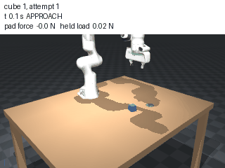

# ruvector-vfa

**A force-aware, memory-augmented robot arm in MuJoCo.** A Franka Panda learns to pick up cubes it cannot tell apart by sight — heavy, slippery, soft, or brittle — by remembering how earlier grasps *felt*.

Inspired by Eka Robotics' Vision-Force-Action idea ("force is the language of manipulation") and the [`ruvector-robotics`](https://github.com/ruvnet/ruvector/tree/main/crates/ruvector-robotics) cognitive crate (`MemorySystem`, `CognitiveCore`, `SkillLearning`), which the memory and cognition layers mirror in Python.



*Two attempts at one cube from `uv run vfa demo --quick --video` (every third frame).*

## What it does

- **Simulates** a 7-DoF Panda on a table with a wrist force/torque sensor, finger touch pads, and an impedance (operational-space) controller: MuJoCo + Gymnasium, tasks reach, lift, and pick-and-place.
- **Hides the physics.** Every cube looks the same; six hidden classes differ in mass, friction, softness, and break force. A grip that holds a heavy cube crushes a brittle one.
- **Feels before it commits.** Each grasp starts with a gentle touch-and-heft probe. Its force signature (closure stiffness, held load, slip) is the retrieval key.
- **Remembers.** Every attempt is stored as vectors built from forces, trajectory, context, and outcome (episodic + semantic memory, cosine search, utility reinforcement, skill consolidation).
- **Thinks at two speeds.** System 1 runs the grasp skill and a slip reflex every control tick; System 2 queries memory at the attempt start, after the probe, and after a failure, and sets the skill parameters θ (grip force, closing speed, lift acceleration, place speed, release height). A safety supervisor can override both.
- **Retries until success**, narrowing the grip window with this cube's own slips and breaks and with similar cubes' outcomes.

## How memory improves performance

Measured on a benchmark frozen (by hash) before any memory code existed, with the same retry budget for every condition. Full tables, protocol, and caveats: [`docs/RESULTS.md`](docs/RESULTS.md).

**Lift, 3 evaluation seeds × 60 cubes** (RESULTS §9.2; targets fixed before the run, §9.1):

| Condition | success@1 (cubes 21–60) | attempts to success | break rate | force jerk [N/s] |
|---|---|---|---|---|
| `naive` (one default θ) | 0.658 | 2.78 | 0.560 | 49.2 |
| `best_fixed` (best single θ) | 0.658 | 2.73 | 0.210 | 38.3 |
| `random_retry` (random θ on retries) | 0.658 | 2.21 | 0.468 | 48.2 |
| `memory_full` | **0.925** | **1.19** | **0.102** | **36.7** |

- **Force is what matters.** With context-only keys (`memory_ctx_only`, no force features) success@1 on cubes 21–60 drops to 0.600 (§9.2–9.3).
- **Similarity search matters.** A Thompson-sampling bandit that learns from the same outcomes without it reaches 0.600 and needs 1.94 attempts (§9.2).
- **It transfers.** A memory that learned on one seed and was then frozen lifted 59 of 60 new cubes at the first attempt (`naive`: 39 of 60; §9.4).
- **Pick-and-place** (§10.3): `memory_full` needs 1.250 attempts per cube, `random_retry` 2.225 (quick seeds); on a fresh seed 1.233 against 2.000.
- **Not everything improves.** Memory grips harder than it needs on slippery cubes: its peak-force excess is higher than `random_retry`'s (10.48 against 7.78 N, §9.6), and `brittle` cubes remain its weakest class.

## Setup

Requires macOS or Linux and [uv](https://docs.astral.sh/uv/). uv installs the pinned Python (`.python-version`; MuJoCo has no wheels for the newest Python releases).

```bash
git clone https://github.com/shaal/ruvector-vfa.git
cd ruvector-vfa
uv sync                      # creates .venv with the project and its dev tools
uv run vfa demo --quick      # 30 cubes: baselines vs memory, with the System 1 / System 2 log
```

Without uv, create a virtual environment with the Python version in `.python-version`, then use pip:

```bash
python3.12 -m venv .venv && . .venv/bin/activate
pip install -r requirements.txt
pip install -e . --no-deps   # the vfa package and its `vfa` command
vfa demo --quick
```

## Run it

```bash
uv run vfa demo --quick                     # lift demo: 30 cubes; writes runs/demo-<time>/ with report.html
uv run vfa demo --quick --task pick_place   # the pick-and-place demo
uv run vfa demo --quick --video             # also writes attempts.gif (the first cube that needed a retry)
uv run vfa demo --seed 501                  # 60 cubes of another seed

uv run python -m vfa.experiments.benchmark --condition memory_full --profile quick --workers 8
uv run python -m vfa.experiments.benchmark aggregate --profile quick
uv run python -m vfa.experiments.run_all --workers 8      # every condition on the evaluation seeds (resumable)

uv run pytest -m "not slow" -q              # fast tests; `-m slow` runs the physics sweeps
uv run ruff check . && uv run ruff format --check .
```

Long runs are chunked and resumable: re-run the same command until it reports every chunk done. Everything a run writes goes under `runs/` (git-ignored).

**macOS and the interactive viewer.** The project renders offscreen (`mujoco.Renderer`), so every command above runs headless. MuJoCo's interactive viewer is different: on macOS it must run under `mjpython`, which ships with the `mujoco` package:

```bash
uv run mjpython -c "import mujoco.viewer; from vfa.sim.scene import build_scene; mujoco.viewer.launch(build_scene())"
```

On Linux, use `uv run python` instead of `uv run mjpython`.

## Project layout

```
src/vfa/
  cli.py          `vfa` entry point: demo, scene-check
  sim/            scene (MjSpec), hidden object classes and the break rule, sensors and events,
                  episode recorder, the Gymnasium env (reach, lift, pick_place)
  control/        operational-space impedance controller, force-controlled gripper, safety supervisor
  skills/         θ (params.py), the grasp-and-lift skill with the probe (pick.py),
                  pick-and-place (place.py), the slip reflex
  memory/         embeddings and retrieval keys, vector backend, episodic/semantic/working memory,
                  skill library
  cognition/      CognitiveCore (System 1 / System 2 / EMERGENCY), the retrieval policy, retries
  experiments/    baselines, the frozen benchmark, bandit baselines, run_all, the demo
  viz/            force plots, learning curves, video, HTML report
configs/          frozen benchmark (objects, profiles, best_fixed θ, hashes), embedding statistics
assets/menagerie/ the vendored Franka Panda (pristine, Apache-2.0)
scripts/          physics spikes and sweeps (T05, T06, T19), fixture builder
tests/            unit, integration, and physics tests; fixtures/calib_episodes.npz
docs/             architecture, results, feasibility, RuVector mapping, extension guide
```

## Read next

| Doc | What it holds |
|---|---|
| [`docs/ARCHITECTURE.md`](docs/ARCHITECTURE.md) | Design and as-built notes: simulation, learning problem, memory, dual-process loop, safety, experiments, decision log |
| [`docs/RESULTS.md`](docs/RESULTS.md) | Every measured number, with the command that produced it |
| [`docs/RUVECTOR_MAPPING.md`](docs/RUVECTOR_MAPPING.md) | Python class ↔ `ruvector-robotics` Rust type, semantic differences, the drop-in plan |
| [`docs/EXTENDING.md`](docs/EXTENDING.md) | Add an object class, a skill parameter, a memory backend, or a task |
| [`docs/FEASIBILITY.md`](docs/FEASIBILITY.md) | The physics spike: grip force × closing speed × hidden class, the slip detector |
| [`ROADMAP.md`](ROADMAP.md) | The task list; each task is one PR with acceptance criteria and a verify command |
| [`docs/BRIEF.md`](docs/BRIEF.md) | The original project brief, verbatim |
| [`CLAUDE.md`](CLAUDE.md) | Rules for the coding agent (environment, probes, frozen benchmark) |

## How it was built

Task by task with [shipyard](https://github.com/shaal/shipyard), which loops the `/ship-next` skill: one reviewed, quality-gated, squash-merged PR per [`ROADMAP.md`](ROADMAP.md) task.

## License

MIT (see [`LICENSE`](LICENSE)). The vendored Franka Panda model keeps its Apache-2.0 license from MuJoCo Menagerie (see [`assets/menagerie/NOTICE.md`](assets/menagerie/NOTICE.md)).
