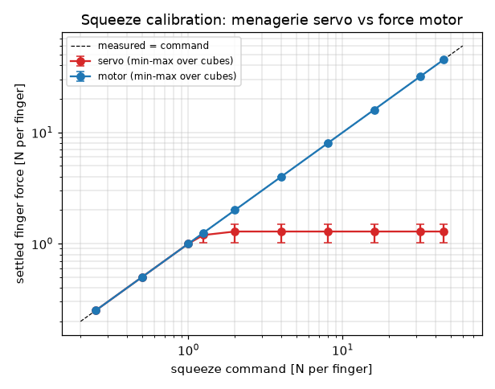
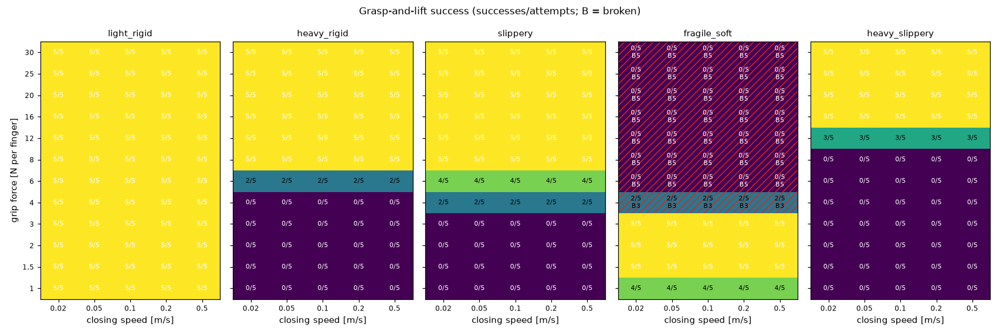
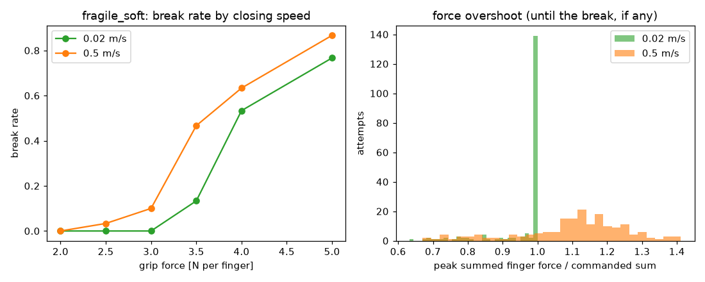
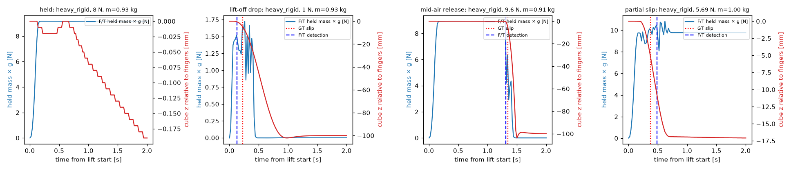

# Feasibility — does force decide grasp success? (T05)

**Verdict: yes.** In this simulation the grip force decides whether a scripted grasp lifts the cube, breaks it, or drops it, and the right force depends on the hidden class. Every class has a success window inside the gripper's range, no single force works for all five classes, a faster close breaks fragile cubes more often at the same requested force, and a held-mass detector on the wrist F/T and accelerometer finds the slips (precision 0.991, recall 0.996 with the simulation's noise-free sensors). Three limits. The conflict is one class against the rest: a single 16 N grip serves the other four classes and the pooled best is 80 %, above T10's 75 % bar (§7). On the 62 attempts whose cube slid only 1–50 mm the detector scores 0.870 / 0.930, and with σ 0.05 N of sensor noise its precision falls below the 0.9 bar (§5; T06 owns the real sensor model).

| Acceptance (ROADMAP T05) | Result |
|---|---|
| Each class has a success window inside the actuator range | Yes. The windows lie between 1 and 30 N per finger; the motor holds 50 N. The 5-cube cells make the window edges coarse (§3) |
| No single grip force succeeds on all five classes | Yes. Every one of the 60 (force, speed) cells leaves at least one class at 0 %; the best serves 4 classes and breaks every `fragile_soft` cube (§3). The conflict is one class against the rest: every `fragile_soft` cube breaks at ≤ 6 N per finger, while all map cubes of the other four classes hold at 16 N (99.7 % of `heavy_slippery` cubes need ≤ 16 N), so the pooled best cell reaches 80 % (§7) |
| Fast closing breaks `fragile_soft` more often than slow closing | Yes, in a narrow force band. 63/180 vs 43/180 breaks on the same 30 cubes at 2–5 N; 19 cubes broke at more forces when fast, 0 when slow (sign test p = 1.9e-6). Alone, only 3.5 N is significant (10 vs 0 fast-only breaks, p = 0.00098); the 5-cube map shows no speed effect (§3, §4) |
| F/T slip detector: precision ≥ 0.9, recall ≥ 0.8 | Yes, as point estimates with noise-free sensors. The detector reads the wrist F/T **and** the wrist accelerometer. Precision 0.991, recall 0.996 on 1939 attempts (43 partial slips included). On held-out cubes, first run after the detector was fixed: 0.919 / 1.000 (34 TP, 3 FP). That is one false alarm from failing (34/38 = 0.895), and its 95 % interval (0.79–0.97) does not rule out a value below 0.9. With sensor noise: 0.919 (σ 0.02 N), 0.773 (σ 0.05 N, below the bar). All 6 false alarms are real 1.4–2.0 mm slips below the 5 mm ground-truth line (§5) |

**Provenance.** The tables in §3–§5 come from `scripts/spike_grip.py` (the full run, `runs/spike/full/`); the figures are copies of its output. Two full runs of the final code gave identical tables and byte-identical figures. The design measurements in §3–§7 that the sweep does not record (the force-branch damping, faster lifts, cone creep, the end stop, the lost object, the speed switches, descent drift, the T03 law on soft cubes, the table sink, the single-core time) come from one-off probes on the final code, marked *probe*. The wall times in §1 are this session's runs. `tests/test_spike_grip.py`, `tests/test_gripper.py`, and `tests/test_scene.py` pin the key ones.

## 1. How to reproduce

```bash
uv run python scripts/spike_grip.py --quick             # 557 attempts, 27-57 s with 8 workers
uv run python scripts/spike_grip.py --workers 8         # 2585 attempts, 109-250 s with 8 workers
uv run python scripts/spike_grip.py --aggregate --out runs/spike/full   # tables + figures only
```

The quick profile is a smoke test: its noise cubes (sample 9000) were seen when the debounce was chosen, so its summary labels them `noise-study`, not held-out. The sweep is chunked (one JSON file per chunk under `runs/spike/<profile>/chunks/`) and resumable: a re-run skips finished chunks, and a wall-clock deadline (`--deadline`, default 8 min) stops it between chunks. Each chunk file records its jobs and a fingerprint of the code (the script, the `vfa` sources, `configs/objects.toml`, the vendored robot, the MuJoCo and numpy versions); a chunk from other code or another plan is re-run, never aggregated. A run directory belongs to one profile. `--aggregate` writes `summary.md`, `metrics.json`, and four PNGs. One attempt takes 0.30–0.39 s of wall time on one core (median of 10 attempts, 14–18× real time, probe). These times were measured on a shared 16-core Mac with a load average of 8–37 from other processes, which explains the spread. The cubes come from `np.random.default_rng((class index, sample))`, so every (force, speed) cell of a class grips the same cubes (a paired design).

## 2. The scripted attempt

`run_attempt` in `scripts/spike_grip.py`, all at 500 Hz under the T03 OSC:

1. Reset, `apply_object`, observe the cube (`observe_cube`, no noise). The grasp yaw is the observed cube yaw, so the fingers close along a face normal.
2. Move to 12 cm above the cube center and settle (1.4 s).
3. Descend to the cube center on a 1.0 s minimum-jerk path with the path velocity fed forward (`vel=`), then settle 0.3 s. The last 0.1 s is the F/T tare window.
4. `Gripper.squeeze(f, speed=v)`. Wait until the gripper reports the force (motor force ≥ 99 % of the request with the fingers stopped), plus 0.15 s, or a timeout.
5. Lift 10 cm on a 1.0 s minimum-jerk path with the velocity fed forward (peak acceleration 0.577 m/s²), then hold 1 s.

The break rule (`BreakMonitor`) runs every tick. **Success** = not broken, and the cube center is ≥ 8 cm above its rest height at the end of the hold. The 2 cm margin covers the OSC payload sag (6.5 mm/kg). **Ground-truth slip** = the cube falls more than 5 mm relative to the fingertip center (`ee` site) after the lift starts. A failed attempt that keeps the cube ≥ 2 cm up is a `SLIP`; otherwise it is a `DROP`.

| Study | What | Attempts (full) |
|---|---|---|
| map | 5 classes × 12 forces (1–30 N per finger) × 5 speeds (0.02–0.5 m/s) × 5 cubes | 1500 |
| speed | `fragile_soft`, forces 2–5 N × speeds 0.02 and 0.5 m/s × 30 cubes (paired) | 360 |
| release | 5 classes × 6 fractions × 4 cubes: lift with 2·F_min (at most 0.4× the break force), then at 1.3 s lower the grip to 0.5, 0.8, 0.9, 0.95, 0.98, or 0.995·F_min | 120 |
| margin | 5 classes × 6 factors × 6 cubes: grip = 0.96–1.06 × the need at the lift's peak acceleration, m(g + 0.577)/(2μ) | 180 |
| noise | 3 sensor-noise levels × 5 harness variants (margin 0.98, 1.0, 1.04, 1.3; release 0.9) × 5 classes × 3 held-out cubes (samples 9100–9102; the quick profile uses sample 9000) | 225 |
| calibration | servo and motor, 10 commands (0.25–45 N) × 2 cubes of each class (unbreakable) | 200 |

F_min = m·g/(2μ) uses the hidden properties. Only the release, margin, and noise studies use it, as a test harness: the map's 5-cube cells are too coarse to land a grip within a few percent of a cube's need, where the partial slips live. No policy sees F_min.

## 3. Squeeze calibration and the success map

**Calibration** (settled per-finger force after a 0.5 s settle, ten cubes per command, all closed at 0.1 m/s; the plot shows the settled force, not the closing peak, which §4 covers):



| command [N] | servo: mean ± std [min, max] | motor: mean ± std [min, max] |
|---|---|---|
| 0.25 | 0.250 ± 0.000 [0.250, 0.250] | 0.250 ± 0.000 [0.250, 0.250] |
| 0.5 | 0.500 ± 0.000 [0.500, 0.500] | 0.500 ± 0.000 [0.500, 0.500] |
| 1 | 1.000 ± 0.000 [1.000, 1.000] | 1.000 ± 0.000 [1.000, 1.000] |
| 1.25 | 1.193 ± 0.077 [1.024, 1.250] | 1.250 ± 0.000 [1.250, 1.250] |
| 2 | 1.285 ± 0.162 [1.024, 1.489] | 2.000 ± 0.000 [2.000, 2.000] |
| 4 | 1.285 ± 0.162 [1.024, 1.489] | 4.000 ± 0.000 [3.999, 4.000] |
| 8 | 1.285 ± 0.162 [1.024, 1.489] | 8.000 ± 0.000 [8.000, 8.000] |
| 16 | 1.285 ± 0.162 [1.024, 1.489] | 16.000 ± 0.000 [16.000, 16.000] |
| 32 | 1.285 ± 0.162 [1.024, 1.489] | 32.000 ± 0.000 [32.000, 32.000] |
| 45 | 1.285 ± 0.162 [1.024, 1.489] | 44.917 ± 0.249 [44.169, 45.000] |

The menagerie position servo is repeatable but flat: it stops at 25·width N per finger (1.02–1.49 N on 4.2–6.0 cm cubes), far below the 3–17 N per finger that the heavy classes need (`heavy_rigid` 3.1–7.4 N, `heavy_slippery` 6.5–16.6 N). **The scene now uses a force motor** (§6). The motor lands every command below 45 N to ≤ 0.001 N. One exception: the 45 N command squeezed the softest, smallest cube (4.17 cm, time constant 0.059) to 2.71 cm wide (probe), inside the end-stop band (the full force needs ≥ 3 cm), so the stop capped it at 44.17 N, the `max_squeeze_force` at that width.

**Success map** (the hatched cells broke cubes):



Closing speed 0.02 m/s (successes / attempts; B = breaks). The 0.05, 0.1, 0.2, and 0.5 m/s tables have the same counts in every cell: 5 cubes per cell cannot show the speed effect, which §4 measures on 30 paired cubes.

| grip [N/finger] | light_rigid | heavy_rigid | slippery | fragile_soft | heavy_slippery | all classes |
|---|---|---|---|---|---|---|
| 1 | 5/5 | 0/5 | 0/5 | 4/5 | 0/5 | 36% |
| 1.5 | 5/5 | 0/5 | 0/5 | 5/5 | 0/5 | 40% |
| 2 | 5/5 | 0/5 | 0/5 | 5/5 | 0/5 | 40% |
| 3 | 5/5 | 0/5 | 0/5 | 5/5 | 0/5 | 40% |
| 4 | 5/5 | 0/5 | 2/5 | 2/5 B3 | 0/5 | 36% |
| 6 | 5/5 | 2/5 | 4/5 | 0/5 B5 | 0/5 | 44% |
| 8 | 5/5 | 5/5 | 5/5 | 0/5 B5 | 0/5 | 60% |
| 12 | 5/5 | 5/5 | 5/5 | 0/5 B5 | 3/5 | 72% |
| 16 | 5/5 | 5/5 | 5/5 | 0/5 B5 | 5/5 | 80% |
| 20 | 5/5 | 5/5 | 5/5 | 0/5 B5 | 5/5 | 80% |
| 25 | 5/5 | 5/5 | 5/5 | 0/5 B5 | 5/5 | 80% |
| 30 | 5/5 | 5/5 | 5/5 | 0/5 B5 | 5/5 | 80% |

Success windows (forces with ≥ 80 % success, the same at every speed). The map has only 5 cubes per cell, so the window edges are coarse. The third column is the corner of the class ranges (largest mass, smallest μ). The last two columns score the edges against the hidden need, m(g + 0.577)/(2μ), of 4000 fresh cubes per class, without physics:

| class | window [N per finger] | hardest cube in the ranges needs | cubes the lower edge holds | cubes whose break force > 2 × the upper edge: slow / fast close |
|---|---|---|---|---|
| light_rigid | 1–30 | 0.97 | 100.0 % | – |
| heavy_rigid | 8–30 | 7.4 | 100.0 % | – |
| slippery | 6–30 | 12.1 | 55.2 % | – |
| fragile_soft | 1–3 | 1.73 | 62.1 % | 100.0 % / 85.3 % |
| heavy_slippery | 16–30 | 16.6 | 99.7 % | – |

So the `slippery` window starts at 6 N because 4 of its 5 map cubes need less, but only 55 % of all `slippery` cubes do; no `slippery` cube needs more than 12.1 N. The `fragile_soft` window at 1 N holds 62 % of the class. At its 3 N upper edge a slow close breaks no cube, because the class's break force is at least 6 N summed. A fast close (0.5 m/s) multiplies the peak by the speed study's median 1.147 at 3 N, which spares only 85 % of the class; the speed study broke 3 of 30 there (§4). Read the windows as "this is where success lives", not as per-cube guarantees. The thresholds follow `F = m(g + a)/(2μ)`: over the map, the smallest grip that succeeded was 1.023× its cube's need and the largest one that failed without a break was 0.956×. The margin study puts the edge within a few percent: at 0.98× every cube slips more than 5 mm at the peak acceleration and 9/30 are still lifted, at 1.00× 26/30 succeed (10 cubes slip, 6 of them still lifted), and from 1.02× all 30 hold. **No single grip force succeeds on all five classes**: every one of the 60 cells leaves at least one class at 0 %. The cells that serve the most classes (four, at 16–30 N) break every `fragile_soft` cube; the fragile window ends at 3 N.

## 4. Closing speed: the force profile matters

`Gripper.squeeze(f, speed=v)` closes the fingers at `v` until the cube stops them; `v` defaults to 0.5 m/s, and only `speed=None` selects the uncapped T03 law (§6). When the moving fingers hit the cube, the squeeze steps by 7.5·v N per finger (the speed servo's damping on the target velocity, never above `f`) and then rises at 250·v N/s to `f` (ARCHITECTURE §3). The fingers (15 g each plus 0.1 kg of joint armature) carry their momentum into the contact, so the force overshoots before it settles. Same 30 `fragile_soft` cubes at both speeds:



| grip [N/finger] | slow (0.02 m/s) breaks | fast (0.5 m/s) breaks | fast-only | slow-only | McNemar p (one-sided) | median peak/command slow | median peak/command fast |
|---|---|---|---|---|---|---|---|
| 2 | 0/30 | 0/30 | 0 | 0 | 1 | 1.000 | 1.267 |
| 2.5 | 0/30 | 1/30 | 1 | 0 | 0.5 | 1.000 | 1.199 |
| 3 | 0/30 | 3/30 | 3 | 0 | 0.12 | 1.000 | 1.147 |
| 3.5 | 4/30 | 14/30 | 10 | 0 | 0.00098 | 1.000 | 1.103 |
| 4 | 16/30 | 19/30 | 3 | 0 | 0.12 | 0.997 | 1.035 |
| 5 | 23/30 | 26/30 | 3 | 0 | 0.12 | 0.798 | 0.828 |
| all | 43/180 | 63/180 | 20 | 0 | – | | |

No cube broke at the slow speed and survived the fast one. The same cube appears at every force, so the pooled pairs are not independent; per cube, 19 of 30 broke at more forces when closing fast and none when closing slow (sign test p = 1.9e-6). The peak ratio below 1 at 4–5 N is the break load: the attempt ends at the first tick past the break force.

On the soft fragile cubes the effect is modest (median overshoot 1.04–1.27 at 0.5 m/s for 2–4 N; MuJoCo's critically damped soft contacts absorb most of the impact). The impact itself barely depends on the request, so it weighs most at small forces and on stiff cubes: a 0.5 m/s close on `light_rigid` peaks at 3.13× (max 3.84×) for 1 N and 1.41× (max 1.58×) for 3 N; on `fragile_soft`, 1.66× (max 1.86×) for 1 N. The force branch has no damping on purpose. A current-controlled gripper motor has no velocity feedback, and the T03 servo damping (10 N·s/m) would hide most of the effect: on the 30 speed-study cubes (unbreakable) at 0.5 m/s it cut the median overshoot from 1.267 to 1.100 at 2 N and from 1.151 to 1.065 at 3 N (probe).

## 5. F/T slip detector

`FTSlipDetector` (in the script; T06 promotes it to `vfa/sim/sensors.py`) uses only the wrist F/T and the wrist's accelerometer, never privileged state:

- **Held mass.** The vertical wrist force over the wrist's vertical proper acceleration (what an accelerometer in the F/T sensor reads, +g at rest) is the mass hanging below the wrist: `m = F_z / a_z`. The tare (0.1 s before the squeeze, fingers open) reads 7.456 N on every noise-free attempt (7.4554–7.4558 N), the weight of the hand subtree (0.760 kg). The held cube's mass is `F_z / a_z − m_hand`, low-passed at 20 Hz. While the cube moves with the hand this is its mass: over the 1114 map and speed attempts that held the cube (fall < 1 mm), the estimate's peak was at most 0.19 % above the true weight and the estimate never fell more than 0.40 % below its running peak (stored 50 Hz traces). Faster lifts do not disturb it: with 1.5× the needed grip (at most 0.4× a fragile cube's break force) and lifts of 1.0, 0.7, 0.5, and 0.35 s (peak 0.58 to 4.71 m/s²), 20 held cubes each gave 0 false alarms (probe).
- **Rule.** Fire once the estimate stays below 0.9 × its running peak for 6 ms (3 ticks), after the peak passed 15 g (0.15 N). In a slip the cube accelerates less than the hand, so the estimate falls. The 0.9 threshold was set on a prototype run of the margin study's cubes. The 6 ms debounce was set on earlier runs, which included the quick profile's noise cubes (sample 9000) and the first held-out cubes (samples 9000–9002): 1–2 ticks fire more on noise, 5–10 ticks miss stick-slip partial slips, whose dips are short. The held-out cubes in the tables below (samples 9100–9102) were first run after both choices were fixed.
- **First draft (rejected).** A load-drop rule (tared F_z, hand inertia removed by a finite-difference acceleration, fire below 0.5 × peak) scored 1.000/1.000 on lift-off drops but missed partial slips: while a cube slides, friction still carries most of its weight. On an earlier probe of near-threshold grips it caught 2 of 51 partial slips (recall 0.66 over all 144 slips there).



| | GT slip | GT no slip |
|---|---|---|
| F/T fired | 671 (TP) | 6 (FP) |
| F/T silent | 3 (FN) | 1259 (TN) |

Precision **0.991** (95 % Wilson interval 0.98–1.00), recall **0.996** (0.99–1.00) over the 1939 noise-free attempts that reached the lift. The detector usually fires before the cube has fallen 5 mm: the detection time minus the ground-truth time has a median of −84 ms (p10 −128 ms, p90 −4 ms). The Wilson intervals treat attempts as independent. The paired design reuses cubes (the map's 25 cubes appear in all 60 cells; the held-out set is 15 cubes × 5 variants), so the intervals are optimistic. By study:

| study | attempts | GT slips | TP | FP | FN | precision (95 % CI) | recall (95 % CI) | median lag |
|---|---|---|---|---|---|---|---|---|
| map | 1310 | 450 | 450 | 0 | 0 | 1.000 (0.99–1.00) | 1.000 (0.99–1.00) | −90 ms |
| speed | 254 | 0 | 0 | 0 | 0 | – | – | – |
| release | 120 | 120 | 120 | 0 | 0 | 1.000 (0.97–1.00) | 1.000 (0.97–1.00) | −62 ms |
| margin | 180 | 70 | 67 | 3 | 3 | 0.957 (0.88–0.99) | 0.957 (0.88–0.99) | −82 ms |
| held-out (new cubes) | 75 | 34 | 34 | 3 | 0 | 0.919 (0.79–0.97) | 1.000 (0.90–1.00) | −72 ms |

40 of the 43 partial slips (ground-truth slip, fall < 50 mm) were detected. The 3 misses are stick-slips at exactly the needed grip (1.00×) on `heavy_slippery` cubes that slid 5.8, 6.0, and 6.6 mm and were still lifted. All 6 false alarms are `light_rigid` cubes at 1.00× that really slipped, by 1.4–2.0 mm, below the 5 mm ground-truth line (6 of the 19 attempts that slipped 1–5 mm fired).

**The headline counts many easy calls.** All 450 map slips are cubes that never rose 5 mm off the table, and 1246 successes moved < 1 mm. On the 62 attempts whose cube fell 1–50 mm relative to the fingers, precision is 0.870 (0.74–0.94) and recall 0.930 (0.81–0.98). Every false alarm is a real slip of 1.4–2.0 mm, so precision depends on where the line sits (1.000 with a 1 mm line):

| GT line [mm] | GT slips | TP | FP | FN | precision | recall |
|---|---|---|---|---|---|---|
| 1 | 693 | 677 | 0 | 16 | 1.000 | 0.977 |
| 2 | 680 | 671 | 6 | 9 | 0.991 | 0.987 |
| 5 (used) | 674 | 671 | 6 | 3 | 0.991 | 0.996 |
| 10 | 669 | 669 | 8 | 0 | 0.988 | 1.000 |

**Sensor noise.** The held-out cubes again, with white Gaussian noise added to F_z and a_z every tick:

| σ F_z [N] | σ a_z [m/s²] | attempts | GT slips | TP | FP | FN | precision | recall |
|---|---|---|---|---|---|---|---|---|
| 0 | 0 | 75 | 34 | 34 | 3 | 0 | 0.919 | 1.000 |
| 0.02 | 0.01 | 75 | 34 | 34 | 3 | 0 | 0.919 | 1.000 |
| 0.05 | 0.02 | 75 | 34 | 34 | 10 | 0 | 0.773 | 1.000 |

At 0.05 N the noise on a light cube's estimate is a sizable fraction of the 10 % band, and false alarms grow. T06 must model the real sensor and size the filter and threshold for it.

**Threshold and debounce** (exact: each attempt records its lowest debounced held-mass/peak ratio, so one run scores every threshold):

| drop fraction | TP | FP | FN | precision | recall |
|---|---|---|---|---|---|
| 0.5 | 632 | 0 | 42 | 1.000 | 0.938 |
| 0.7 | 638 | 0 | 36 | 1.000 | 0.947 |
| 0.8 | 649 | 0 | 25 | 1.000 | 0.963 |
| 0.85 | 658 | 0 | 16 | 1.000 | 0.976 |
| 0.88 | 668 | 2 | 6 | 0.997 | 0.991 |
| 0.9 | 671 | 6 | 3 | 0.991 | 0.996 |
| 0.92 | 672 | 10 | 2 | 0.985 | 0.997 |
| 0.95 | 674 | 19 | 0 | 0.973 | 1.000 |
| 0.97 | 674 | 19 | 0 | 0.973 | 1.000 |

| debounce window [ticks of 2 ms] | noise-free | σ 0.02 N, 0.01 m/s² | σ 0.05 N, 0.02 m/s² |
|---|---|---|---|
| 1 | 0.974 / 1.000 | 0.850 / 1.000 | 0.756 / 1.000 |
| 2 | 0.980 / 0.999 | 0.872 / 1.000 | 0.756 / 1.000 |
| 3 (used) | 0.991 / 0.996 | 0.919 / 1.000 | 0.773 / 1.000 |
| 5 | 1.000 / 0.976 | 1.000 / 0.912 | 0.816 / 0.912 |
| 10 | 1.000 / 0.961 | 1.000 / 0.882 | 0.816 / 0.912 |

(precision / recall at the 0.9 threshold)

Ground truth (largest fall of the cube relative to the fingertip center), noise-free attempts, by outcome:

| outcome | < 1 mm | 1–5 mm | 5–20 mm | 20–50 mm | ≥ 50 mm |
|---|---|---|---|---|---|
| SUCCESS | 1246 | 19 | 25 | 0 | 0 |
| SLIP | 0 | 0 | 10 | 8 | 0 |
| DROP | 0 | 0 | 0 | 0 | 631 |

Partial slips exist only within a few percent of a cube's need (the release, margin, and noise studies; the map and speed studies have none); everywhere else a cube either holds with < 1 mm of movement or falls away.

## 6. What T05 changed, and why

| Change | Where | Why (measured) |
|---|---|---|
| Gripper `actuator8` becomes a force motor on the tendon (ctrl = tendon force, ±100 N = 50 N per finger); the servo stays as `SceneConfig(gripper="servo")` | `vfa/sim/scene.py` | The servo caps the squeeze at 25·width N per finger (1.02–1.49 N), below every heavy class's need (§3). ROADMAP asks for "ctrl = squeeze force in N": `Gripper.squeeze` takes the per-finger squeeze in N, and `ctrl` stays the tendon force that ARCHITECTURE §3 specified (ctrl = −2 × the squeeze) |
| `Gripper.squeeze(f, speed=v)` (0.001–0.5 m/s, default 0.5): speed-limited close with a bumpless start, then a ramp of 250·v N/s per finger; anti-windup; re-sending a command changes nothing, and a changed command keeps the moving target; the target advances at most 10 ms per tick | `vfa/control/gripper.py` | The closing profile is the second skill parameter (`close_speed`); without a speed cap a squeeze from open overshoots 1.6–2.0× (T03) |
| `speed` defaults to 0.5 m/s; the uncapped T03 law needs `speed=None` (review round 3) | `vfa/control/gripper.py` | The T03 law hits a soft cube at several m/s: 30 N on a 5 cm cube with time constant 0.04 ended at −50 mm width with 145 N per finger, and `open()` did not free it; a 4 cm stiff cube at 40 N ended at −53 mm (probe). With the default speed all six probed cases (10–50 N on 4–5 cm cubes with time constant 0.02–0.08, at 500 and 100 Hz) stay above 25 mm width, settle on the request or the end-stop cap at their width, peak at most 1 % above the summed request, and `open()` reopens to 8 cm |
| The anti-windup bound feeds the speed forward (its speed term capped at c·v); a changed speed-limited squeeze keeps its target and clock (review rounds 3–4) | `vfa/control/gripper.py` | Before, a weak squeeze closed below its speed (0.5 N at 0.5 m/s peaked at 0.37 m/s and settled at 0.07 m/s; 0.25 N at 0.13 and 0.04 m/s, probe), and a command that changed every tick never closed (it re-placed the target at the fingers each tick). Without the cap, a held 2 N squeeze fell to 0.01 N for more than 0.5 s when a stiff cube pushed the fingers open. Tests pin all three. The map and speed-study tables did not change |
| The speed servo never pulls the fingers open while a pad's touch sensor reads contact; after a gap of more than 10.5 ms between `apply` calls a squeeze (changed or not) restarts its target, and two such gaps in a row raise (review rounds 4–8) | `vfa/control/gripper.py` | Switching a fast probe (2 N, 0.5 m/s) to a slower squeeze at contact braked the fingers and pulled them off soft cubes: contact force 0 for 3–14 ticks (time constant 0.04–0.06, probe). Now the motor never pulls open and contact holds in all 48 probed switches (500 and 100 Hz; the default cube and time constants 0.015–0.08; four target commands). It is not bumpless: the motor force can drop to 0 for up to 0.22 s while the slower target catches up, and the contact force falls to 0.017 N on the softest cube (probe). After a gap, the stale target reopened the fingers at 0.06 m/s; now a restart after a gap sits no further open than a hold would place it, and at the fingers when ctrl froze on an opening force. Two review probes drove this: a restart that kept a frozen end-stop brake force flew the fingers 48 mm open at 100 Hz, and a frozen closing force while a push opened the fingers kept pushing them open for 78 ticks (tests pin both). `apply` must run every tick at ≥ 100 Hz: slower calls stall the fingers or make the speed servo unstable, so two gaps in a row raise `RuntimeError` |
| End stop: below 3 cm the closing force is capped (to 0 at 5 mm), and inside that band fast fingers are braked | `vfa/control/gripper.py` | A motor squeezing ≥ 5 N on nothing jammed the fingers (T03: −11 mm at 5 N, −49 mm at 20 N, still there after `open()`) |
| The two fingers never collide (`exclude` pair) | `vfa/sim/scene.py` | With the end stop alone, a 50 N squeeze without a speed still jams the finger meshes into each other: −47 mm at 500 and 100 Hz, still there after `open()` (pinned by a test). With both, a squeeze on nothing comes to rest and reopens to 8 cm in every probed case (5, 10, 20, 50 N; with and without a speed; 100 and 500 Hz). With the default speed the fingers stop a little inside the 5 mm stop (3.4 mm at 500 Hz; down to 1.6 mm at 100 Hz before they settle at 5 mm), never below 0. Without one they reach 1.5–8.0 m/s and overrun past 0 for a moment (−8 mm at 20 N, −28 mm at 50 N, 500 Hz); below the stop nothing pushes them back, so they rest at 0.5–5 mm (probe) |
| Elliptic friction cones, `impratio = 10` | `vfa/sim/scene.py` | Pyramidal cones with impratio 1 let a held cube slide 2.9–9.4 mm in the grip over the 2 s lift and hold at 1.1× the need at the lift's peak acceleration (1.5–5.5 mm at 2×; one cube per class, probe); elliptic: 0.12–0.47 mm at 1.1× (0.02–0.21 mm at 2×), and 0.9× drops with both cones. Throughput: 0.458–0.469 s (elliptic) vs 0.470–0.482 s (pyramidal) per 10 s T03 episode (probe, loaded machine) |
| Not changed: after a lost object the fingers close under the held squeeze | `vfa/control/gripper.py` | The speed limits the approach only. Holding 20–50 N, a removed cube lets the fingers reach 1.9–4.3 m/s at 500 Hz and 2.0–5.0 m/s averaged over a 10 ms tick at 100 Hz. The end stop and the finger joint limits stop them (at 50 N, 0.5 m/s they overrun to −9 mm width at 500 Hz and −30 mm at 100 Hz), and `open()` reopens to 8 cm (probe). A brake that dropped the target's lead on overspeed cut the 500 Hz speeds to 0.7–1.7 m/s, but it pulled the fingers off soft cubes again in 6 of the 40 fast→slow switches, where the pad touch sensor missed the first contact. So the gripper keeps closing after a loss, as a force-controlled one does |

**Class ranges after T05: unchanged.** `configs/objects.toml` keeps the T04 values (ARCHITECTURE §4): every T05 acceptance criterion passed with them. They are not the benchmark's final ranges: T10 must widen the conflict before it freezes them (§7).

| Class | Mass (kg) | Friction μ | Softness (solref time constant) | Break force (N, summed) |
|---|---|---|---|---|
| `light_rigid` | 0.05–0.15 | 0.8–1.0 | stiff, 0.015–0.025 | none |
| `heavy_rigid` | 0.6–1.0 | 0.7–1.0 | stiff, 0.015–0.025 | none |
| `slippery` | 0.15–0.35 | 0.15–0.30 | stiff, 0.015–0.025 | none |
| `fragile_soft` | 0.05–0.20 | 0.6–0.9 | soft, 0.04–0.08 | 6–12 |
| `heavy_slippery` | 0.5–0.8 | 0.25–0.40 | stiff, 0.015–0.025 | none |

## 7. Handoffs and risks

- **T10 `best_fixed` ≤ 75 % is at risk.** The best single (force, speed) pooled over the five classes is 16 N at 0.02 m/s with **80 %** (20/25 here). It succeeds on every class except `fragile_soft`, so with equal class weights a fixed θ that sacrifices one class scores 80 %. T10 must widen the conflict in `configs/objects.toml` (for example, a second class that fails at high grip, or class weights) and re-measure. T05 did not change the classes: its own criteria passed, and the benchmark is T10's to freeze.
- **T06: the detector needs a wrist accelerometer and a noise model.** The held-mass estimate uses the wrist's proper acceleration (`mj_objectAcceleration` on the wrist site; a real F/T sensor with an IMU reports the same). T06 should add it as a scene sensor, model the sensor noise, and re-size the filter, threshold, and debounce (§5: at σ 0.05 N the held-out precision falls to 0.773; noise-free, the 1–50 mm slips score 0.870 / 0.930). The estimate is also the heft probe's mass reading.
- **`close_speed` also sets the force ramp and the impact.** A slow speed with a large force is a slow grasp (30 N at 0.02 m/s ramps for 6 s; in the map the squeeze took 7.2–8.1 s), and a fast close hits hard at small forces (3.1× on a stiff cube at 1 N, 0.5 m/s). T08's bounds on θ must keep the squeeze inside the attempt budget, and the speed must stay within 0.001–0.5 m/s. Skills always pass a speed: the default is the fastest close (the hardest impact), and `speed=None` is the T03 law, which only tests use. Grasp at the cube's center height, as the spike does: the pad touch sensors also read the table, and fingertips that drag on it were not part of any T05 study.
- **Descents need the feed-forward velocity.** Over 35 cubes a 12 cm, 1.0 s minimum-jerk descent drifted 7.2 mm sideways without `vel=` (median; max 7.9 mm) and 1.8 mm with it (max 2.0 mm, probe). In an earlier full run with a rate-limited descent target (13.6 mm median drift), a fingertip landed on a 5.9 cm cube (10.5 mm clearance per side) and broke it before the squeeze. T08's approach, descent, and lift must feed the path velocity forward.
- **The probe signal.** Elliptic cones remove the friction coupling of the contact sink (ARCHITECTURE §4, T05 handoff (1)): a settled cube now sinks 0.08–0.14 mm (stiff) or 0.46–0.75 mm (soft) into the table, set by softness alone (probe, seeds 0–2 of every class: 0.077–0.144 mm and 0.463–0.748 mm).
