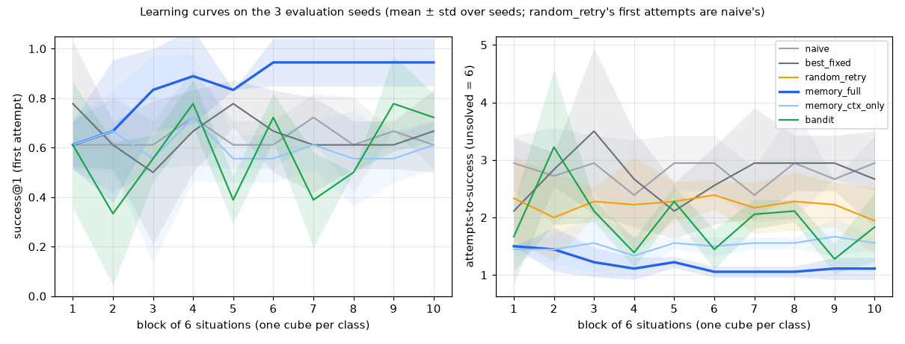
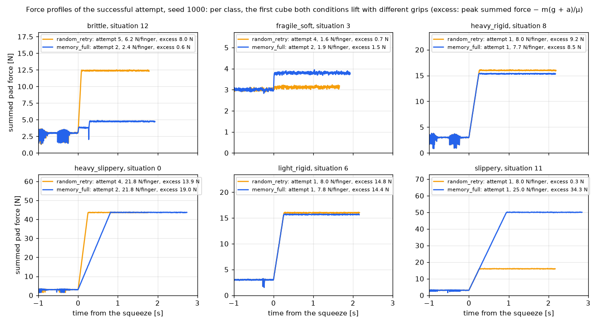

# Results — ruvector-vfa

Measured numbers only, each from the session that wrote it (CLAUDE.md). T10 sets the yardstick: the frozen benchmark and the three non-adaptive baselines. T15, T17a, and T18 add their conditions on the same benchmark.

## 1. The frozen benchmark (T10)

`configs/benchmark.toml` + `configs/objects.toml` + `configs/best_fixed.toml`, SHA-256 `f3c0a3c89f8c51db9a69ab8d32b9592845b843174950659700b63a9c529c4b02` (`configs/benchmark.sha256`, written by `benchmark freeze`, checked by `tests/test_benchmark_frozen.py`).

| Setting | Value |
|---|---|
| Task | lift (`PandaVFAEnv`, osc at 500 Hz, the T08 skill, the T09 supervisor on) |
| Hidden classes | six (ARCHITECTURE §4); situations come in blocks of one cube per class, each block in a seeded order, so the index does not reveal the class |
| Situations | 60 per seed; the cube from `default_rng((seed, i))`, the same for every condition; policies see only an opaque situation key |
| Seeds | evaluation 1000, 1001, 1002; calibration 0, 1; quick (tuning) 500, 501; held-out 2000 (T18) |
| Retry budget | `max_attempts = 5` for every condition |
| Sensor noise | `REALISTIC_NOISE`; attempt `a` of situation `i` resets with the same seed in every condition (paired) |
| Profiles | `quick` 2 seeds × 60; `full` 3 seeds × 60; `calib` 2 seeds × 60; `heldout` 1 seed × 60 |

The `quick` profile uses two tuning seeds with 60 situations each (the user's decisions in T10, against the ROADMAP's "1 seed, 15 situations"): later tasks tune on it without touching the evaluation seeds, and a learning curve pools its halves over both seeds (60 situations per half; one seed of 15 would give halves of 7 cubes). The halves are not equally hard for a fixed θ: pooled first-attempt successes, first half / second half, are `naive` 38 / 42 (0.633 / 0.700; `random_retry` the same), `best_fixed` 43 / 38. A learning check on `quick` (T15, T16) must therefore beat `naive`'s own gain on the same situations, not only show a rise.

**Throughput** (`python -m vfa.experiments.benchmark throughput`, 60 naive attempts on one core, machine load 9.2): wall time per attempt median 0.919 s, p95 1.010 s, **71 attempts/min per core**, 5.70 s of sim time on average. The machine's load moves the wall time a lot. One condition on one seed is at most 300 attempts (about 4–5 min on one core), run in chunks of 15 situations; with `--workers 8` a whole condition on `full` (12 chunks) took 55–76 s and one on `quick` (8 chunks) 33–41 s, at load 9–13.

## 2. Baselines (T10, `full` profile)

`python -m vfa.experiments.benchmark --condition <c> --profile full --workers 8`, then `aggregate --profile full`. Mean ± sample std over the 3 evaluation seeds; rates per attempt unless stated; force metrics over successful attempts (`vfa/experiments/benchmark.py`).

| Condition | success@1 | success@5 | success@1, situations 21–60 | attempts-to-success | break rate | situations with a break | drop rate | peak-force excess [N] | force jerk [N/s] |
|---|---|---|---|---|---|---|---|---|---|
| `naive` (8 N, 0.6 m/s²) | 0.639 ± 0.010 | 0.644 ± 0.010 | 0.658 ± 0.014 | 2.78 ± 0.04 | 0.560 | 0.272 | 0.160 | 7.97 | 49.2 |
| `best_fixed` (5 N, 0.3 m/s²) | 0.650 ± 0.033 | 0.661 ± 0.025 | 0.658 ± 0.029 | 2.73 ± 0.15 | 0.210 | 0.100 | 0.463 | 5.09 | 38.3 |
| `random_retry` | 0.639 ± 0.010 | **0.828 ± 0.025** | 0.658 ± 0.014 | **2.21 ± 0.15** | 0.468 | 0.272 | 0.111 | 7.78 | 48.2 |

No safety stop occurred in any condition. Per class, success@1 / success@5 (mean over seeds):

| Class | `naive` | `best_fixed` | `random_retry` |
|---|---|---|---|
| light_rigid | 1.00 / 1.00 | 1.00 / 1.00 | 1.00 / 1.00 |
| heavy_rigid | 1.00 / 1.00 | 0.83 / 0.87 | 1.00 / 1.00 |
| slippery | 1.00 / 1.00 | 0.60 / 0.63 | 1.00 / 1.00 |
| fragile_soft | 0.00 / 0.00 | 0.40 / 0.40 | 0.00 / 0.43 |
| heavy_slippery | 0.47 / 0.50 | 0.07 / 0.07 | 0.47 / 0.87 |
| brittle | 0.37 / 0.37 | 1.00 / 1.00 | 0.37 / 0.67 |

- **`best_fixed` success@1 = 0.650 ≤ 0.75**: no grid θ solves the benchmark (0.675 on the calibration seeds, 0.650 on the evaluation seeds); it needs adaptation (acceptance met). For T18's first target (+15 points) the like-for-like bar compares the same window: `best_fixed` scores 0.658 over situations 21–60, so memory needs 0.808 there (the ROADMAP's wording also allows `best_fixed`'s overall 0.650, i.e. 0.800). The 40 late situations do not hold every class equally often (two classes have 6 cubes, four have 7, per seed).
- **`random_retry` success@5 = 0.828 and 2.21 attempts-to-success**: the bar for memory's attempts-to-success.
- A fixed θ almost never gains from retries (success@5 − success@1 ≤ 0.011): sensor noise rarely changes an outcome. Random retries reach the classes a fixed θ cannot, with breaks on the way.
- Both fixed θ break `fragile_soft` cubes; beyond that they fail different classes: 8 N (`naive`) breaks most `brittle` cubes, 5 N (`best_fixed`) drops most `heavy_slippery` and many `slippery` cubes. Both land near two thirds.
- Force jerk is over successful attempts; the realistic pad noise adds a floor of about 19 N/s to it in quadrature, so differences between conditions look smaller than they are.

## 3. Calibration and the class change (T10)

`python -m vfa.experiments.benchmark calibrate --workers 8 --write`: one attempt per calib situation (120) for each of 30 grid θ (grip 1–25 N × lift 0.3 or 1.0 m/s²; the other fields naive). The selection rule (highest success@1, ties to the lower grip, then the lower acceleration) was fixed before the first run.

**With the five T04 classes** (and the first situation order, class `i mod 5`) the best θ was 12 N at 0.3 m/s² with success@1 **0.800**: every class but `fragile_soft` at 1.00, as T05 predicted (FEASIBILITY §7). That is above the 0.75 bar, so T10 widened the class conflict in `configs/objects.toml`.

**The change:** a sixth class, `brittle` (stiff, 0.20–0.35 kg, μ 0.45–0.60, breaks at 12–20 N summed). It needs at most about 4 N per finger and breaks at 6 N or more, so the grip that holds the heavy classes breaks it and the `fragile_soft` grip lets it slide; T05's other lever, the closing speed, no longer breaks anything after T08's slow probe. `scripts/probe_classes.py` (benchmark noise; lift 0.6 m/s², the other θ fields naive): the T08 skill at 5 N lifted 20 of 20 `brittle` cubes, and at 12 N broke 10 of 10.

**With six classes** (the frozen benchmark) the best θ is **5 N at 0.3 m/s², success@1 0.675** on the calibration seeds (per class: brittle 1.00, light_rigid 1.00, heavy_rigid 0.95, slippery 0.65, fragile_soft 0.40, heavy_slippery 0.05). Every grid θ from 15 N up scores 0.667 (it breaks both breakable classes). Each class alone is solvable: its best grid θ scores 1.00 (fragile_soft and light_rigid at 1 N, brittle at 2.5 N, heavy_rigid at 8 N, heavy_slippery at 12 N, all at 0.3 m/s²; slippery at 10 N and 1.0 m/s²), so the gap to 1.00 comes from the conflict, not from impossible cubes. With 20 cubes per class the calibration is noisy, and the winner beat the 0.667 plateau of the high grips by one situation; the frozen rule and grid stand.

**Probe separability** (`scripts/probe_classes.py`: 20 cubes per class, the T08 probe, benchmark noise).

| Class | heft peak [N] | indentation [mm] | slides in the probe |
|---|---|---|---|
| light_rigid | 0.55–1.40 | 0.052–0.249 | 0 / 20 |
| heavy_rigid | 2.53–3.59 | 0.020–0.063 | 20 / 20 |
| slippery | 0.54–1.01 | 0.030–0.117 | 20 / 20 |
| fragile_soft | 0.55–1.82 | 0.333–1.399 | 0 / 20 |
| heavy_slippery | 0.87–1.34 | 0.021–0.067 | 20 / 20 |
| brittle | 1.53–2.05 | 0.030–0.102 | 20 / 20 |

`brittle`'s heft peak lies between `heavy_slippery`'s and `heavy_rigid`'s, the two classes whose grips conflict with it; `fragile_soft` stands apart by its indentation. `slippery` and `heavy_slippery` overlap, but a high grip serves both.

## 4. Calibration fixture (T10)

`uv run python scripts/make_fixtures.py --workers 8` → `tests/fixtures/calib_episodes.npz`: the `calib` profile with `naive` (attempts 1–2) and `random_retry` (attempts 2–3; its attempt 1 is naive's), observable signals at 50 Hz plus θ, probe features, context, event counts, outcome, an opaque situation group, and a `prev` link from each retry to the attempt before it; hidden labels (class, mass, friction, break force, situation index) in separate `hidden_*` arrays for test scoring only; episodes in a fixed shuffled order. 243 episodes (light_rigid 20, heavy_rigid 20, slippery 26, fragile_soft 77, heavy_slippery 49, brittle 51; 95 successes, 108 breaks, 31 drops, 9 slips), 3.20 MB.

## 5. Embeddings (T11)

`uv run pytest -q tests/test_embeddings.py -s` on `tests/fixtures/calib_episodes.npz`, one first attempt per cube (120 cubes; class labels from `hidden_class`, for scoring only): the mean cosine of same-class pairs minus that of cross-class pairs.

| Key | Dims | Gap |
|---|---|---|
| `key_probe` (context + probe) | 50 | **0.839** |
| `key_pre` (context only) | 12 | −0.006 |

The probe separates the classes (acceptance: gap ≥ 0.1); the observed context does not, as designed. A calibration attempt replayed live gives the fixture's keys (cosine > 0.9999), and the `key_probe` built from the recorder at `PROBE_DONE` equals the one built from the finished episode.

## 6. Retrieval and retry on `quick` (T15)

`uv run python -m vfa.experiments.benchmark --condition <c> --profile quick --workers 8` for `memory_full` and `memory_ctx_only` (the force ablation: every key is the context key); each first runs `naive` on the same code. The `quick` seeds (500, 501; 60 situations each) are T10's tuning seeds, so these numbers are in-sample. The policy's thresholds (ARCHITECTURE §7) have not changed since the first memory run; later logic fixes ran on these same seeds. One memory chunk (a whole seed, in order) took about 45–60 s.

The gate, fixed before the first run: pooled over both seeds, `memory_full`'s success@1 on situations 30–59 must be above its own on 0–29 and above `naive`'s on 30–59.

| Condition | success@1, 0–29 | success@1, 30–59 | success@1 | success@5 | attempts-to-success | break rate |
|---|---|---|---|---|---|---|
| `naive` | 0.633 | 0.700 | 0.667 | 0.667 | 2.67 | 0.499 |
| `memory_full` | 0.817 | **0.950** | **0.883** | **1.000** | **1.13** | **0.066** |
| `memory_ctx_only` | 0.617 | 0.583 | 0.600 | 1.000 | 1.575 | 0.237 |

The halves pool 60 situations each; the last four columns are means over the two seeds (success@1 per seed: `naive` 0.650 / 0.683, `memory_full` 0.867 / 0.900, `memory_ctx_only` 0.600 / 0.600).

**Gate met.** `memory_full` rises from 0.817 to 0.950 and beats `naive` in both halves. Bootstrap over situations (10 000 draws, seed 0; each half resampled separately as one index array, paired across conditions; 95 % intervals): its rise +0.133 [+0.033, +0.250]; its lead over `naive` +0.183 [+0.083, +0.283] on 0–29 and +0.250 [+0.150, +0.367] on 30–59. Its rise is also larger than `naive`'s own (+0.067), the stricter bar of §1, but that difference is not resolved: +0.067 [−0.083, +0.217]. The robust claim is the lead over `naive`, which grows once memory holds a few cubes per class.

success@1 per block of 6 situations (one cube per class), pooled over both seeds:

| Block | 1 | 2 | 3 | 4 | 5 | 6 | 7 | 8 | 9 | 10 |
|---|---|---|---|---|---|---|---|---|---|---|
| `naive` | 0.58 | 0.58 | 0.58 | 0.67 | 0.75 | 0.67 | 0.58 | 0.75 | 0.75 | 0.75 |
| `memory_full` | 0.58 | 0.92 | 0.83 | 0.83 | 0.92 | 0.83 | 0.92 | 1.00 | 1.00 | 1.00 |
| `memory_ctx_only` | 0.58 | 0.67 | 0.50 | 0.67 | 0.67 | 0.67 | 0.67 | 0.75 | 0.42 | 0.42 |

First-attempt successes per class (20 cubes each, both seeds):

| Class | `naive` | `memory_full` | `memory_ctx_only` |
|---|---|---|---|
| `brittle` | 12 | 15 | 6 |
| `fragile_soft` | 0 | 16 | 2 |
| `heavy_rigid` | 20 | 20 | 18 |
| `heavy_slippery` | 9 | 15 | 9 |
| `light_rigid` | 20 | 20 | 20 |
| `slippery` | 19 | 20 | 17 |

- With empty memory the probe decision keeps the default θ, so a first cube is paired with `naive` (`tests/test_retry.py` checks one bit for bit); only a slip escalation, which raises the grip, can differ.
- `memory_ctx_only` solves every cube within 5 attempts through the retry bisection alone, but its first attempts get worse than `naive`'s in the second half (0.583 vs 0.700): with context keys the 0.8 threshold admits cubes of other classes, whose grips mislead. The first-attempt gain comes from the force features at the probe.
- `memory_full`'s first-attempt failures are in `brittle` (5), `heavy_slippery` (5), and `fragile_soft` (4). A replay of both seeds logged each failed first decision: 12 of the 14 kept the default grip because no stored attempt reached similarity 0.8 (early in a run, or a cube that felt unlike the earlier ones of its class), and 2 followed a single similar success of another cube.

**Calibration seeds** (`--profile calib`, seeds 0 and 1; not held out: their `naive` and `random_retry` episodes are the fixture that fit the embedding statistics, T13's clustering constants, and the similarity scale behind `SIM_STRONG`): `memory_full` 0.783 on 0–29 and 0.900 on 30–59 (success@1 0.842, success@5 1.000, attempts-to-success 1.19, break rate 0.084); `naive` 0.583 and 0.633 (0.608, 0.617, 2.94, 0.507).

**Sensitivity** (information only; `memory_full` on `quick` with one constant changed, pooled success@1 on 0–29 → 30–59): the setting used, 0.817 → 0.950; `SIM_STRONG` 0.75: 0.817 → 0.950, 0.85: 0.767 → 0.867; `MARGIN` 0.05: 0.800 → 0.950, 0.2: 0.800 → 0.950; `SIGMA0` 0: 0.800 → 0.950, 0.3: 0.817 → 0.950. Every setting stays above `naive`'s 0.700 on 30–59.

## 7. The demo (T16)

`uv run vfa demo --quick`: 30 cubes of benchmark seed 500 (a `quick` tuning seed), up to 5 attempts each, the three conditions on the same cubes and reset seeds. 28 s wall (baselines in background processes, memory in the foreground), exit 0.

| Condition | success@1 | success@1, cubes 15–29 | success@5 | attempts-to-success | break rate |
|---|---|---|---|---|---|
| `naive` | 0.600 | 0.600 | 0.600 | 3.00 | 0.577 |
| `random_retry` | 0.600 | 0.600 | 0.867 | 2.10 | 0.475 |
| `memory_full` | 0.800 | **0.867** | **1.000** | **1.27** | **0.079** |

The memory ends with 38 attempts and 3 consolidated skills. These are the first 30 situations of the `quick` run of §6 on one seed, so they repeat part of that in-sample result.

## 8. Bandit baselines on `quick` (T17a)

`uv run python -m vfa.experiments.benchmark --condition <c> --profile quick --workers 8` for `bandit` and `bandit_flat` (each first runs `naive`; 92 s and 69 s wall; one bandit chunk, a whole seed in order, took 63–68 s), and for `best_fixed`, `random_retry`, `memory_full`, and `memory_ctx_only` on the same code, then `aggregate --profile quick`. The bandits are reported, not gated. The `quick` seeds are T10's tuning seeds, so the numbers are in-sample; the arm grid and the bin counts (`configs/bandit.toml`) were fixed before the first bandit run and not changed. The re-runs of `memory_full` and `memory_ctx_only` reproduce §6 exactly.

| Condition | success@1, 0–29 | success@1, 30–59 | success@1 | success@5 | attempts-to-success | break rate | drop rate |
|---|---|---|---|---|---|---|---|
| `naive` | 0.633 | 0.700 | 0.667 | 0.667 | 2.667 | 0.499 | 0.179 |
| `best_fixed` | 0.717 | 0.633 | 0.675 | 0.692 | 2.575 | 0.239 | 0.408 |
| `random_retry` | 0.633 | 0.700 | 0.667 | 0.900 | 1.983 | 0.419 | 0.092 |
| `bandit` | 0.467 | 0.633 | 0.550 | 0.958 | 1.950 | 0.105 | 0.389 |
| `bandit_flat` | 0.467 | 0.600 | 0.533 | 0.975 | 1.858 | 0.182 | 0.272 |
| `memory_full` | 0.817 | **0.950** | **0.883** | **1.000** | **1.133** | **0.066** | **0.022** |

Halves pool 60 situations each; the other columns are means over the two seeds (success@1 per seed: `bandit` 0.533 / 0.567, `bandit_flat` 0.567 / 0.500).

First-attempt successes per class (20 cubes each, both seeds):

| Class | `naive` | `memory_full` | `bandit` | `bandit_flat` |
|---|---|---|---|---|
| `brittle` | 12 | 15 | 7 | 4 |
| `fragile_soft` | 0 | 16 | 11 | 8 |
| `heavy_rigid` | 20 | 20 | 7 | 12 |
| `heavy_slippery` | 9 | 15 | 8 | 8 |
| `light_rigid` | 20 | 20 | 20 | 20 |
| `slippery` | 19 | 20 | 13 | 12 |

- **Memory beats a learner without similarity search.** `memory_full` against `bandit`: success@1 0.883 vs 0.550 (0.950 vs 0.633 on 30–59) and 1.133 vs 1.950 attempts-to-success. T18 measures the gap on the evaluation seeds.
- **The bandits learn, but slowly.** `bandit` rises from 0.467 to 0.633 and `bandit_flat` from 0.467 to 0.600; both stay under `naive`'s 0.700 on 30–59. Every bucket starts with 24 arms at Beta(1, 1); the 7 or 8 buckets that cubes reach see 3–12 cubes per seed, fewer than one per arm, so their draws stay close to random arms. `heavy_rigid`, which `naive` lifts 20 of 20 times, succeeds at the first attempt 7 of 20 times with `bandit`, and 0.389 of the bandit's attempts drop the cube (`naive` 0.179). A likely contributor, not tested: the three closing speeds triple the arms per grip, although after the probe T08 found the same peak and no break at 0.05 and 0.5 m/s.
- **Retries pay off.** The bandits reach success@5 0.958 and 0.975 (`random_retry` 0.900) with fewer breaks (0.105 and 0.182 against 0.419). Most of the break gap is in retries: 13 of `bandit`'s 109 retries break, 67 of `random_retry`'s 106. The likely cause, not tested, is the arm grid: half of its grips are under 3 N, while `random_retry` draws grips uniformly up to 25 N. Their attempts-to-success, 1.950 and 1.858, are close to `random_retry`'s 1.983.
- **The probe buckets trade breaks for drops.** They separate the classes only in part: 69 % of first attempts fall in their class's most common bucket (by class, 0.45 for `heavy_rigid` to 0.85 for `fragile_soft` and `heavy_slippery`). `bandit` against `bandit_flat`: success@1 0.550 vs 0.533, inside the seed spread (std 0.024 and 0.047); break rate 0.105 vs 0.182, but drop rate 0.389 vs 0.272.

## 9. Full experiments and ablations (T18)

### 9.1 Protocol (fixed before the first evaluation run)

Memory, the bandits, and the ablations run on the evaluation seeds (1000, 1001, 1002; 60 situations each) for the first time here. The rules below were committed before that run, and the method does not change after it; a missed target follows CLAUDE.md (*Missed numeric targets*).

- **Runs.** `uv run python -m vfa.experiments.run_all --workers 8` until every chunk is done, then `run_all aggregate` and `run_all figures`. Conditions on `full`: `naive`, `best_fixed`, `random_retry`, `memory_full`, `memory_ctx_only`, the four component ablations, `bandit`, `bandit_flat`.
- **Held-out run** (`heldout`, seed 2000): `memory_frozen` runs `memory_full` on the warm-up seed 1000 (all 60 situations, unscored), freezes the memory (no store, no reinforcement, no consolidation), and is scored on seed 2000. Each frozen cube's own attempts stay in a per-situation scratch, so its retries are still bounded by its failures. On seed 2000 it is compared with `naive`, `best_fixed`, `random_retry`, and a fresh `memory_full` that learns online.
- **Ablations** (one `RetrievalPolicy` flag each): `memory_no_reinforce` never reinforces (every utility stays 0.5); `memory_no_semantic` never consolidates and never asks the skill library; `memory_no_failure_bounds` takes no bound from any failure, so a retry without a strong success neighbour repeats the default grip; `memory_no_probe` keeps θ at the probe and makes the whole proposal at the retry start, from the failed attempt's `key_probe`. Its first attempt is `naive`'s by construction (no key before the probe separates the classes, T11), so its success@1 gap is the whole first-attempt gain of the probe decision; its informative number is attempts-to-success.
- **Targets** (means over the 3 seeds): (1) `memory_full` success@1 over situations 21–60 ≥ `best_fixed`'s over the same window + 0.15. This is the like-for-like bar of §2. The looser reading (`best_fixed`'s overall success@1 + 0.15) is reported too, and a result between the two counts as a miss. (2) `memory_full` attempts-to-success < `random_retry`'s. (3) `memory_full` peak-force excess or force jerk < `random_retry`'s.
- **Comparisons with `memory_full`** (the force ablation, the component ablations, the bandits): the per-seed difference (mean ± std) and a paired bootstrap 95 % interval over the 180 situations pooled over seeds (10 000 draws, seed 0; success@1 resamples situations 21–60 only). A component's sentence comes from the success@1 (21–60) and attempts-to-success intervals: removing it makes at least one measurably worse and none better → *it helps*; the reverse → *it hurts*; both → *mixed*; neither → *no measurable effect*. Break rate is reported, not classified.
- **Regression check.** The code fingerprint changed, so the baselines re-run on `full`; they must reproduce §2 (`naive` success@1 0.639, `best_fixed` 0.650 and 0.658 on 21–60, `random_retry` success@5 0.828). On `quick`, `memory_full`, `memory_ctx_only`, `bandit`, and `bandit_flat` reproduced §6 and §8 exactly on this code.
- **Smoke run on `quick`** (in-sample; nothing was tuned on it): `memory_no_reinforce` and `memory_no_semantic` changed some θ but no outcome (success@1 0.883, attempts-to-success 1.133, as `memory_full`); `memory_no_probe` 0.667 and 1.350; `memory_no_failure_bounds` 0.700 and 2.433.

### 9.2 Results on the evaluation seeds

Two invocations of `run_all --workers 8` ran the 74 chunks (5 min 33 s and 2 min 9 s; a learning chunk, a whole seed in order, took 68–114 s, the held-out chunk with its warm-up 133 s). The baselines reproduce §2 exactly, so the regression check passed. No safety stop occurred in any condition. Mean ± sample std over the 3 evaluation seeds; rates per attempt; force metrics over successful attempts.

| Condition | success@1 | success@1, 21–60 | success@5 | attempts-to-success | break rate | peak-force excess [N] | force jerk [N/s] |
|---|---|---|---|---|---|---|---|
| `naive` | 0.639 ± 0.010 | 0.658 ± 0.014 | 0.644 ± 0.010 | 2.78 ± 0.04 | 0.560 ± 0.044 | 7.97 ± 0.46 | 49.2 ± 7.8 |
| `best_fixed` | 0.650 ± 0.033 | 0.658 ± 0.029 | 0.661 ± 0.025 | 2.73 ± 0.15 | 0.210 ± 0.011 | 5.09 ± 0.22 | 38.3 ± 3.8 |
| `random_retry` | 0.639 ± 0.010 | 0.658 ± 0.014 | 0.828 ± 0.025 | 2.21 ± 0.15 | 0.468 ± 0.031 | 7.78 ± 0.96 | 48.2 ± 5.8 |
| `memory_full` | 0.856 ± 0.019 | 0.925 ± 0.000 | 1.000 ± 0.000 | 1.19 ± 0.07 | 0.102 ± 0.015 | 10.48 ± 1.96 | 36.7 ± 1.7 |
| `memory_ctx_only` | 0.600 ± 0.050 | 0.600 ± 0.050 | 1.000 ± 0.000 | 1.52 ± 0.06 | 0.197 ± 0.037 | 8.62 ± 1.51 | 40.4 ± 4.2 |
| `memory_no_reinforce` | 0.861 ± 0.025 | 0.933 ± 0.014 | 1.000 ± 0.000 | 1.18 ± 0.08 | 0.098 ± 0.022 | 10.51 ± 1.99 | 36.8 ± 1.7 |
| `memory_no_semantic` | 0.856 ± 0.019 | 0.925 ± 0.000 | 1.000 ± 0.000 | 1.19 ± 0.07 | 0.102 ± 0.015 | 10.48 ± 1.96 | 36.7 ± 1.7 |
| `memory_no_probe` | 0.639 ± 0.010 | 0.658 ± 0.014 | 1.000 ± 0.000 | 1.39 ± 0.05 | 0.195 ± 0.011 | 8.09 ± 0.39 | 41.0 ± 1.9 |
| `memory_no_failure_bounds` | 0.683 ± 0.029 | 0.733 ± 0.014 | 0.717 ± 0.029 | 2.48 ± 0.20 | 0.616 ± 0.020 | 9.21 ± 0.28 | 54.8 ± 5.6 |
| `bandit` | 0.578 ± 0.079 | 0.600 ± 0.050 | 0.950 ± 0.029 | 1.94 ± 0.21 | 0.137 ± 0.023 | 11.31 ± 1.90 | 49.3 ± 2.8 |

**Targets: all three met.**

1. `memory_full` success@1 over situations 21–60 is **0.925** (0.925 on each seed). The bar is `best_fixed`'s 0.658 + 0.15 = **0.808**; the looser reading gives 0.800.
2. `memory_full` attempts-to-success is **1.19**, against `random_retry`'s **2.21**.
3. Met on force jerk only: **36.7** against **48.2** N/s. The peak-force excess is *higher*: 10.48 against 7.78 N (§9.6).

### 9.3 Ablations and the bandits

Difference from `memory_full` (condition − `memory_full`): mean ± std over seeds, then the paired bootstrap 95 % interval over situations. Verdicts follow the rule of §9.1.

| vs `memory_full` | Δ success@1, 21–60 | Δ attempts-to-success | Δ break rate | verdict |
|---|---|---|---|---|
| `memory_ctx_only` | -0.325 ± 0.050 [-0.417, -0.242] | 0.33 ± 0.03 [+0.23, +0.43] | 0.095 ± 0.021 [+0.050, +0.142] | memory_full better |
| `memory_no_reinforce` | 0.008 ± 0.014 [+0.000, +0.025] | -0.01 ± 0.01 [-0.02, +0.00] | -0.005 ± 0.008 [-0.013, +0.000] | no measurable effect |
| `memory_no_semantic` | 0.000 ± 0.000 [+0.000, +0.000] | 0.00 ± 0.00 [+0.00, +0.00] | 0.000 ± 0.000 [+0.000, +0.000] | no measurable effect |
| `memory_no_probe` | -0.267 ± 0.014 [-0.350, -0.192] | 0.21 ± 0.02 [+0.14, +0.27] | 0.093 ± 0.004 [+0.056, +0.131] | it helps |
| `memory_no_failure_bounds` | -0.192 ± 0.014 [-0.267, -0.125] | 1.29 ± 0.14 [+1.01, +1.61] | 0.514 ± 0.019 [+0.439, +0.580] | it helps |
| `bandit` | -0.325 ± 0.050 [-0.417, -0.233] | 0.75 ± 0.16 [+0.56, +0.96] | 0.034 ± 0.014 [-0.009, +0.080] | memory_full better |
| `bandit_flat` | -0.392 ± 0.038 [-0.475, -0.308] | 0.80 ± 0.04 [+0.60, +1.01] | 0.103 ± 0.010 [+0.045, +0.164] | memory_full better |

- **Force features** (`memory_ctx_only`, the force ablation): they help. With context keys only, success@1 over 21–60 falls by 0.325, to 0.600, under `naive`'s 0.658, and attempts-to-success rises by 0.33.
- **Reinforcement** (`memory_no_reinforce`, utility fixed at 0.5): no measurable effect. Some θ changed, but success@1 over 21–60 moved by +0.008 [+0.000, +0.025] and attempts-to-success by −0.01 [−0.02, +0.00].
- **Semantic tier and skill library** (`memory_no_semantic`): no measurable effect. Every outcome in all 180 situations is the same as `memory_full`'s; the records are identical on seeds 1000 and 1002. The skill is asked only when no stored success reaches similarity 0.8, and on these seeds it never changed an outcome.
- **The probe decision** (`memory_no_probe`): it helps. Without it the first attempt is `naive`'s (success@1 over 21–60 −0.267, to 0.658), and the retries, which still use the failed attempt's force signature, need 0.21 more attempts.
- **Failure bounds** (`memory_no_failure_bounds`): they help. Without them a retry repeats the default grip unless a similar success exists: success@5 falls to 0.717, attempts-to-success rises by 1.29, and the break rate by 0.514.
- **The bandits.** `memory_full` beats a learner without similarity search: against `bandit`, success@1 over 21–60 is 0.325 higher [0.233, 0.417] and attempts-to-success 0.75 lower [0.56, 0.96]; `bandit_flat` is further behind.

### 9.4 Held-out run (seed 2000)

`memory_frozen` learned on the 60 situations of seed 1000, then ran the 60 new situations of seed 2000 with no further writes. One seed, so no spread.

| Held-out (seed 2000) | success@1 | success@1, 21–60 | success@5 | attempts-to-success | break rate |
|---|---|---|---|---|---|
| `naive` | 0.650 | 0.650 | 0.650 | 2.75 | 0.590 |
| `best_fixed` | 0.683 | 0.625 | 0.683 | 2.58 | 0.184 |
| `random_retry` | 0.650 | 0.650 | 0.850 | 2.10 | 0.462 |
| `memory_full` | 0.900 | 0.950 | 1.000 | 1.12 | 0.075 |
| `memory_frozen` | 0.983 | 0.975 | 1.000 | 1.03 | 0.016 |

The frozen memory transfers to new cubes: its first attempts succeed in 59 of 60 situations, against 54 for a fresh `memory_full` that starts empty on this seed and 39 for `naive`. At the first attempt the fresh memory fails 4 of 10 `brittle` cubes, 1 `fragile_soft`, and 1 `heavy_slippery`; the frozen memory fails 1 `brittle` cube.

### 9.5 Figures

`run_all aggregate` draws the learning curves; `run_all figures` re-ran seed 1000's `random_retry` and `memory_full` with every episode saved, checked that their records equal the scored chunks' (but for wall times), and drew the force profiles.

### 9.6 Analysis

**Memory improves movement on new seeds.** On seeds it was never tuned on, `memory_full` lifts 0.856 of the cubes at the first attempt (0.925 after the first 20 situations) and every cube within 5 attempts, in 1.19 attempts on average. The fixed baselines stay near 0.65, and `random_retry` needs 2.21 attempts with a break rate of 0.468. The gain needs all three of its working parts: the force features, the decision at the probe, and the bounds from failures. Removing any one costs at least 0.19 of success@1 over situations 21–60. Two parts add nothing measurable on this benchmark: utility reinforcement and the skill library.

**Where memory still fails.** 26 of its 180 first attempts failed: 13 `brittle` breaks, 7 `fragile_soft` breaks, 5 `heavy_slippery` under-grips, and 1 `heavy_rigid` slip. In situations 21–60, 9 remain: 6 `brittle` breaks, 2 `fragile_soft` breaks, and 1 `heavy_slippery` drop. `brittle` is the weak class: memory lifts 17 of 30 `brittle` cubes at the first attempt, while `best_fixed` (5 N) lifts all 30. A likely cause, not measured here: a `brittle` cube's heft lies between the two heavy classes' (§3), so a heavy neighbour can pass the 0.8 threshold and set a grip that breaks it. 5 of the 7 `fragile_soft` breaks are in the first 11 situations, before memory holds a similar success.

**Gentler, but not with less force.** `memory_full`'s force jerk (36.7 N/s) is lower than every baseline's and both bandits', but its peak-force excess is higher than `random_retry`'s (10.48 against 7.78 N). The excess comes from the slippery classes: 18.3 against 4.4 N on `slippery` and 16.0 against 7.7 N on `heavy_slippery`. A likely cause, not measured here: both classes slide in the probe (§3), so a `slippery` cube's strong neighbours include `heavy_slippery` successes at high grips. Memory then lifts the cube at the first attempt, with more force than it needs (the `slippery` panel above: 25 N per finger, an excess of 34.3 N). The realistic pad noise adds about 19 N/s to every jerk value in quadrature.

**The bandit learns, but without similarity search it stays far behind.** `bandit` lifts 0.578 of the cubes at the first attempt and needs 1.94 attempts (`random_retry` 2.21, `memory_full` 1.19). It breaks less than `random_retry` (0.137 against 0.468) but drops more (0.320 against 0.111).
